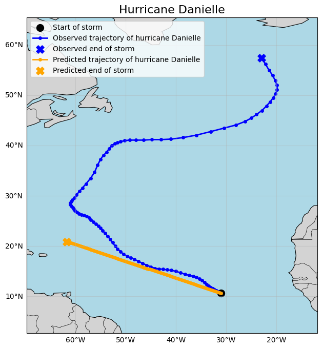
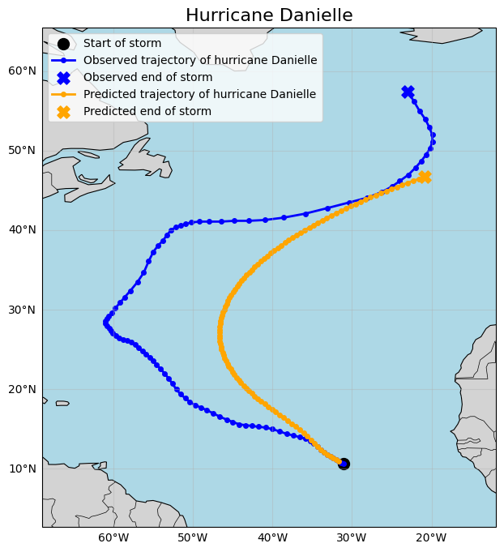
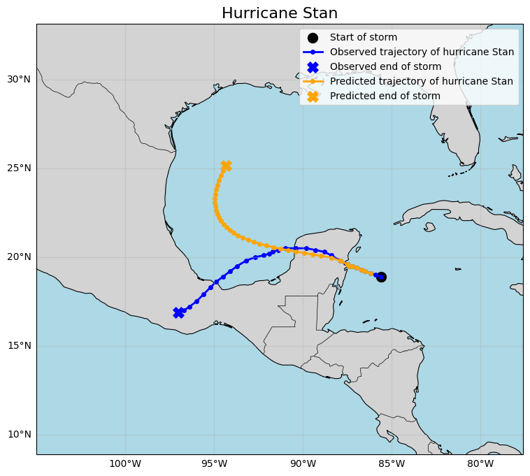

# Hurricance-Trajectory-Prediction

Analysis and prediction of hurricane trajectories using NOAA IBTrACS-Data

## Overview

The main goal of this project is to predict multiple positions of hurricanes in the future
using different machine-learning-models like Linear Regression and XGBoost.

## Workflow

1. data acquisition
2. feature engineering
3. data exploration
4. creating suitable training data
5. model training and evaluation
6. visualization of predicted trajectory

## Study Area

North Atlantic.

## Years

1980-2026

## Results

### Data Exploration

First some of the features were used to create new features like the change in wind direction, as the current features only represented the current state of the hurricane and no change in perspective to the last known state of the hurricane.

Then some basic Exploratory Data Analysis was performed on the data to maybe find interesting behavior in the dataset regarding the storms current position

### Machine Learning

As the data only describes the state of a hurricane in a given position, some code had to be written to create training and test data. To achieve this, storm were divided into training and test data. The data was then used to create training samples by using a certain amount of consecutive data as input and the longitude and latitude of the next known position or a specific point in time like 24h ahead as target.

To find some simple prediction the following models could try to beat a simple model was created that just used a hurricanes first known movement for a linear prediction of all the remaining positions.

The first machine-learning-model created was a linear regression model which showed some understanding of a typical hurricane trajectory that most of the time passed the USA at the east cost towards the Northern Atlantic but therefore also had its problems with more unpredictable trajectories

XGBoost was also evaluated as an alternative but achieved worse predictions than the linear regression.

As the prediction of the entire hurricane rajectory is quite impossible and by that not really usefull the models were also trained to predict the position of the hurricane at a certain point in time in the future. For the meassurement of the prediction error the haversine distance was used to meassure the distance between two coordinates. Out of the three models, Linear Regression, XGBoost and GRU all of them achieved quite good predictions with XGBoost as the best of the three.

| Model  | Mean Haversine Distance |
| ------------- | ------------- |
| Linear Regression  | 184 km  |
| XGBoost  | 174 km  |
| GRU  | 234 km  |